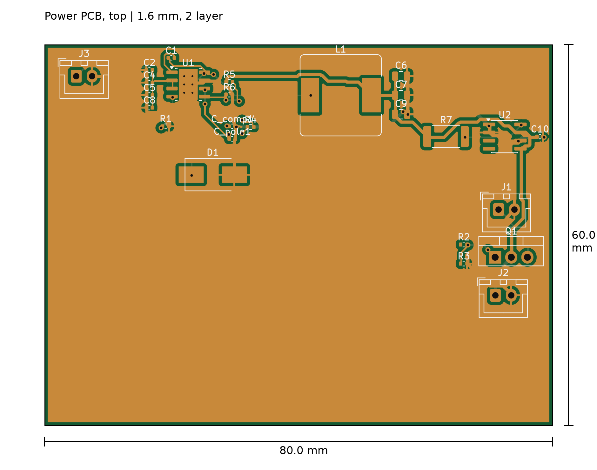
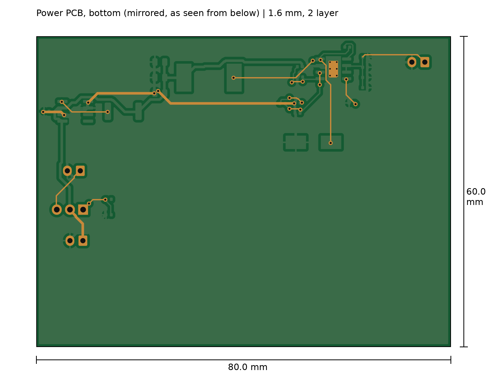

# Power Control PCB, Rev A

This is the custom power board for the plate imaging system. It takes the input supply in, runs a buck converter to make a 5 V rail for the Raspberry Pi 5, drives the white LED backlight from a Pi PWM signal through a MOSFET, and has an INA219 for current and voltage telemetry over I2C.

I designed it in KiCad (schematic, layout, DRC) and had Rev A fabricated. The boards are in hand. Before assembly, I reviewed the fabricated design against its own netlist and found issues that block bring-up. They're listed under Known issues. Rev A is a fabricated design, not working hardware yet.

The renders above come straight from the fab Gerbers in `fab/gerbers/`.

## Status

| Stage | State |
|---|---|
| Schematic | Done (`kicad/colony_counter_power.kicad_sch`) |
| Layout and DRC | Done. Final DRC: 0 errors, 0 unconnected pads, 23 warnings (`fab/DRC_final.rpt`) |
| Fabrication | Done. Rev A boards received. |
| Design review against the fabbed netlist | Done (2026-11-03). Blocking issues found, see below. |
| Assembly | Not started |
| Bring-up and test | Not started |
| Rev B | Needed before assembly, or Rev A reworked by hand |

## What's in this folder

| Path | Contents |
|---|---|
| `kicad/` | KiCad 10 project and schematic |
| `fab/gerbers/` | Fab output as ordered: copper, mask, silk, Edge.Cuts, PTH/NPTH drill, and the job file (KiCad 10.0.3, 2026-06-24) |
| `fab/DRC_final.rpt` | DRC report for the routed board |
| `bom/colony_counter_power_BOM.csv` | KiCad BOM export. It's stale in two places; see Known issues. |
| `images/` | Top and bottom renders with dimensions |

The routed layout file (`colony_counter_power_routed.kicad_pcb`) that the Gerbers came from isn't in my local project folder yet. The `.kicad_pcb` in that folder is an earlier, partly routed snapshot. I left it out so nobody mistakes it for the fabbed board. Until I recover the routed file, the Gerbers are the record of what was built.

## Circuit

The connectivity below is read from the netlist attributes embedded in the fab Gerbers.

| Block | Parts | Notes |
|---|---|---|
| Input | J3 `USB_C_PWR`, JST XH 2-pin | Input caps C2, C4, C5, C8 on VIN |
| 5 V buck | U1 TPS54560B, L1 12 uH (Bourns SRR1260), D1 Schottky catch diode (SMC), C6/C7/C9 3x 47 uF output | FB divider R5 53.6k / R6 10.2k sets Vout = 0.8 V x (1 + 53.6/10.2) = 5.0 V. RT = R1 243k. Compensation: R4 16.9k, C_comp1 4.7 nF, C_pole1 47 pF. Bootstrap: C1 100 nF. |
| Pi power out | J2 `PI_PWR`, JST XH 2-pin | 5 V and GND |
| LED drive | Q1 IRLZ44N (TO-220), R2 100 ohm gate, R3 10k gate pulldown, J1 `LED_PWR` | Gate driven from `LED_PWM` |
| Telemetry | U2 INA219, R7 0.1 ohm shunt (2512), C10 100 nF | I2C on SDA/SCL, A0 = A1 = GND (address 0x40) |

## Known issues (Rev A)

| # | Issue | Evidence | Effect | Fix |
|---|---|---|---|---|
| 1 | **The input isn't connected to the regulator.** J3 pin 1 is its own net. Its bottom-layer trace stops under C2's top-layer pad with no via. | `Net-(J3-Pin_1)` contains only J3.1. DRC `track_dangling` at (72.075, 52.075) mm. | No power reaches U1. The board can't start. | Schematic: wire J3.1 to the VIN/input-cap net. Rev A rework: a jumper from J3 pin 1 to the C2 to C8 VIN pads. |
| 2 | **EN is tied straight to VIN.** U1 pins 2 (VIN) and 3 (EN) share one net. | `Net-(U1-EN)` contains U1.2 and U1.3. TI datasheet: EN absolute maximum is 8.4 V, and EN has an internal pull-up that enables the part when EN floats. | Once #1 is fixed, a 12 V input puts EN about 3.6 V over its absolute maximum. | Let EN float, or add a UVLO divider. On Rev A, separate pin 3 from VIN before powering up. |
| 3 | **The current shunt isn't in the current path.** R7 has one end on +5 V and the other end only on INA219 IN+. | `Net-(U2-IN+)` contains only R7.2 and U2.8. The buck output, the loads and IN- are all on the +5 V net. | The INA219 reads bus voltage but 0 A. | Route the buck output into IN+, through R7, and out of IN- to the loads. |
| 4 | **The LED MOSFET is wired high-side as a source follower.** Q1's drain is on +5 V, its source goes to J1 (LED+), and J1's other pin is GND. | Pad nets for Q1.2, Q1.3, J1.1 and J1.2 | With a 3.3 V gate drive from the Pi, the LED only gets roughly the 3.3 V gate voltage minus Q1's gate threshold. That's too low to drive a white LED at full brightness, and the PWM dimming won't behave as intended. | Use low-side switching: LED+ to the supply, LED- to drain, source to GND. |
| 5 | **No connector for the Pi signals.** `LED_PWM`, `SDA` and `SCL` each land on a single pad (R2.1, U2.3, U2.4). | Net list | There's no way to connect the Pi's PWM or I2C to the board without fly wires to 0402 and SOIC pads. | Add a header carrying LED_PWM, SDA, SCL and GND. |
| 6 | The input cap value doesn't match the order. The schematic and BOM say 2.2 uF for C2, C4, C5 and C8; 1 uF was ordered. | Schematic and BOM vs the order sheet | Lower input capacitance than designed | Settle the value, then update the schematic and BOM |
| 7 | The BOM export is stale: it lists D1 as SOD-123, but the board uses an SMC footprint. The proposed B340AE-13 substitute (SMA, lower ratings) was rejected. | BOM vs footprint | Wrong part risk at ordering | Re-export the BOM from the routed project |

Minor items to check in Rev B:
- J2 is a JST XH, rated about 3 A, feeding a Pi 5.
- Feeding 5 V in through the GPIO header caps the Pi 5's USB current unless that's configured.
- The 23 DRC warnings are 20 silkscreen items, 2 library-footprint mismatches, and the dangling track that's issue #1.

## Mechanical (for the enclosure)

| Item | Value |
|---|---|
| Outline | 80.0 x 60.0 mm rectangle with square corners |
| Thickness | 1.6 mm, 2 layers, ground pour on both sides |
| Parts | All on top. The bottom only has through-hole leads, so allow at least 3 mm under the board. |
| Mounting holes | **None** (the NPTH file is empty) |
| Free area | The bottom strip, y > 41 mm, is empty across the full 80 mm |

Part positions are in mm from the top-left corner, x to the right and y down, taken from the pad coordinates in the Gerbers:

| Ref | Part | Position | Approx. height | Note |
|---|---|---|---|---|
| J3 | Input, JST XH vertical | pins (5.0, 5.0) and (7.5, 5.0) | ~7 mm, plus the plug | Cable enters at the top-left |
| U1 | TPS54560B | (22.7, 6.3) | <2 mm | Runs warm |
| D1 | SMC diode | (26.5, 20.5) | ~2.5 mm | |
| L1 | SRR1260 inductor | (46.7, 8.0) | ~6 mm | Tallest SMD part |
| R7 | Shunt, 2512 | (63.2, 14.5) | <1 mm | |
| U2 | INA219 | (72.5, 14.5) | <2 mm | |
| J1 | LED out, JST XH vertical | pins (71.5, 26.0) and (74.0, 26.0) | ~7 mm, plus the plug | Cable exits on the right |
| Q1 | IRLZ44N, TO-220 vertical | pins (71.0, 33.5), (73.5, 33.5), (76.0, 33.5) | **~19 mm with the tab** | Sets the lid clearance. Needs airflow. |
| J2 | Pi power out, JST XH vertical | pins (71.0, 39.5) and (73.5, 39.5) | ~7 mm, plus the plug | Cable exits on the right |

The heights are typical datasheet values. I'll measure the real parts before the enclosure is final.

**Mounting:**
- On Rev A, I'll hold the board by its edges with a slot, card guide or clips.
- For Rev B, I'll add M3 holes at the top-right and both bottom corners, which are clear. The top-left corner is blocked by J3.
